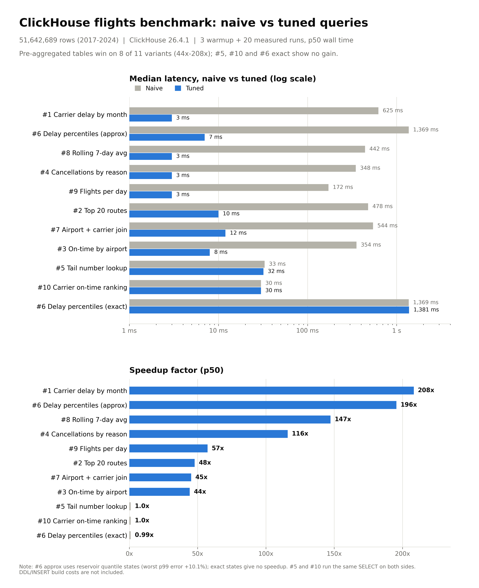

# bts-ch

US flight delays, naive vs tuned, in ClickHouse.

Ten analytical questions over BTS On-Time Performance data. Each question is
answered twice: a naive scan of the raw `flights` table, and a tuned query
over pre-aggregated tables, materialized views, and a projection. Measured
with `clickhouse-benchmark`. The result is a benchmark that shows, question
by question, why the tuned warehouse wins, and where it does not.

## Dataset

- **Source:** US DOT BTS On-Time Performance (Air OnTime), monthly CSVs from
  [transtats.bts.gov](https://transtats.bts.gov/PREZIP/)
- **Subset:** 2017-2024, **51,642,689 rows**, one ClickHouse node
- **Server:** ClickHouse 26.4.1 on ClickHouse Cloud (asia-southeast1)

## Results

`clickhouse-benchmark`, 3 warmup runs + 20 measured iterations per query,
executed sequentially per pair under identical server conditions. Output
equivalence (values, columns, row order) verified for every pair before
benchmarking. DDL and backfill costs are not included: one-time build vs
recurring read.

| # | query | naive p50 | tuned p50 | speedup | rows read per run |
|---|-------|----------:|----------:|--------:|-------------------|
| 1 | avg delay by carrier by month | 0.625 s | 0.003 s | 208.3x | 51.6M -> 1.5K |
| 6a | delay distribution by weekday, approx quantiles | 1.369 s | 0.007 s | 195.6x | 51.6M -> 7 |
| 8 | rolling 7-day delay per airport | 0.442 s | 0.003 s | 147.3x | 51.6M -> 386 |
| 4 | cancellations by reason by quarter | 0.348 s | 0.003 s | 116.0x | 51.6M -> 4 |
| 9 | flights per day | 0.172 s | 0.003 s | 57.3x | 51.6M -> 2.9K |
| 2 | top 20 routes | 0.478 s | 0.010 s | 47.8x | 51.6M -> 101K |
| 7 | delay by airport+carrier, with metadata | 0.544 s | 0.012 s | 45.3x | 51.6M -> 101K |
| 3 | on-time rate by airport by year | 0.354 s | 0.008 s | 44.2x | 51.6M -> 101K |
| 5 | all flights for one tail number on one date | 0.033 s | 0.032 s | 1.0x | 16K -> 16K |
| 10 | on-time ranking for one airport, one season | 0.030 s | 0.030 s | 1.0x | 1.1M -> 1.1M |
| 6b | delay distribution by weekday, exact quantiles | 1.369 s | 1.381 s | 1.0x | 51.6M -> 7 |



Full output per query: [results/flights_benchmark.txt](results/flights_benchmark.txt).

## What the numbers say

- **Pre-aggregation is the big lever.** AggregatingMergeTree summaries cut
  every recurring aggregate question from ~350-625 ms to 3-12 ms, 44-208x,
  because the query reads hundreds of rows instead of 51.6 million.
- **Exact quantile states are not a free lunch.** Query 6 with
  `quantileExact` states runs at the same speed as the raw scan: the state
  holds every value, so merging re-deserializes as much data as the scan.
  Reservoir states (`quantile` sample of 8192 per group) read 7 rows and run
  196x faster; p50 stays exact, worst p99 error is +10.1% and shrinks vs the
  tail. `dow_summary` carries both families, one table, two accuracy points.
- **Projections only pay where the key matches.** Query 5 (tail number +
  date lookup) is served by a projection at 1.0x: the primary key
  `(tail_number, flight_date)` already prunes to 2 granules, 16K rows.
  Query 10 is identical on both sides: no tuned structure yet.
- **A plain `ORDER BY` is a skip index.** Query 10 reads ~1.1M rows for a
  4-month window on one airport because the date sits second in the key.

## The ten questions

See [queries/questions.txt](queries/questions.txt) for the plain-language list.
Every pair lives in [queries/naive/](queries/naive/) and [queries/tuned/](queries/tuned/),
one file per question, tuned files note which structure serves them:

| # | question |
|---|----------|
| 1 | Average departure and arrival delay by carrier, by month, full range |
| 2 | Top 20 routes by flight volume and by average delay |
| 3 | On-time percentage by airport, by year |
| 4 | Cancelled flights by cancellation reason, by quarter |
| 5 | All flights for a tail number on a specific date |
| 6 | Departure delay distribution (min, max, avg, p50, p90, p99) by weekday |
| 7 | Flights and avg delay by airport and carrier, joined with metadata |
| 8 | Rolling 7-day average delay per major airport |
| 9 | Flight counts per day, full history |
| 10 | Carrier on-time ranking for one origin airport, one season |

## Run it yourself

Requirements: Docker with Compose.

```bash
docker compose up -d          # single node ClickHouse 26.4
scripts/load.sh               # download BTS 2017-2024, load, build tuned structures
scripts/bench.sh              # rerun the benchmark, 3 warmup + 20 runs per query
```

`load.sh` downloads the monthly zips from BTS (several GB, transtats is
slow), lowercases the headers to match the table, strips the `.00` float
suffix so Bool columns parse, and streams each month in with
`input_format_csv_empty_as_default`. It then applies `sql/02_aggregates.sql`
(summary tables, MVs, projection, backfills) and `sql/03_dictionaries.sql`.

Query the data directly:

```bash
docker compose exec clickhouse clickhouse-client --query "$(cat queries/tuned/1.sql)"
```

Or open http://localhost:8123/play in a browser.

Note: the benchmarked 51.6M-row instance was a specific 2017-2024 insert; a
fresh local load may land within a few million rows of it. The relative
speedups are the point, not the absolute row count.

## Layout

```
queries/naive/     the 10 questions as plain SELECTs on flights
queries/tuned/     same questions against the tuned structures
queries/questions.txt
sql/01_flights.sql       base table DDL
sql/02_aggregates.sql    summary tables, MVs, projection, backfills
sql/03_dictionaries.sql  airport and cancellation-reason dictionaries
scripts/load.sh          docker + download + load + build
scripts/bench.sh         rerun the benchmark locally
results/                 benchmark output text + charts
```
