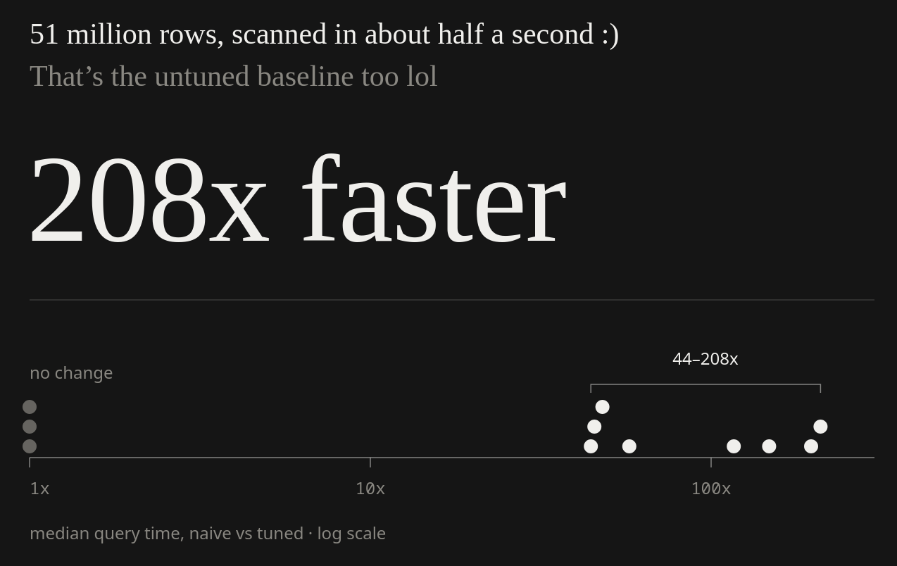
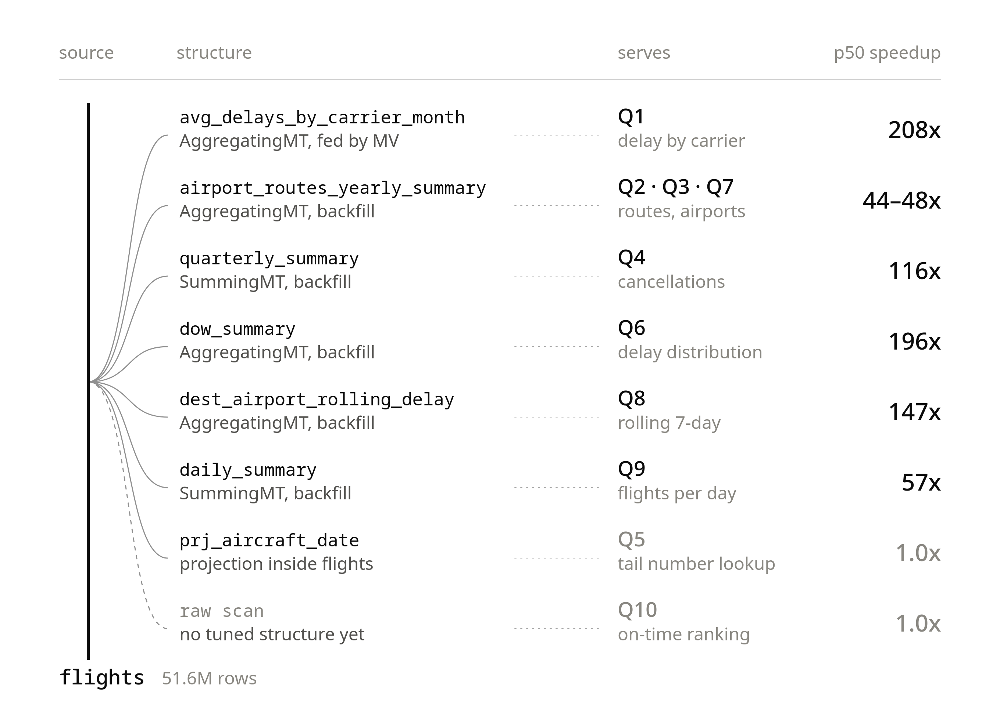
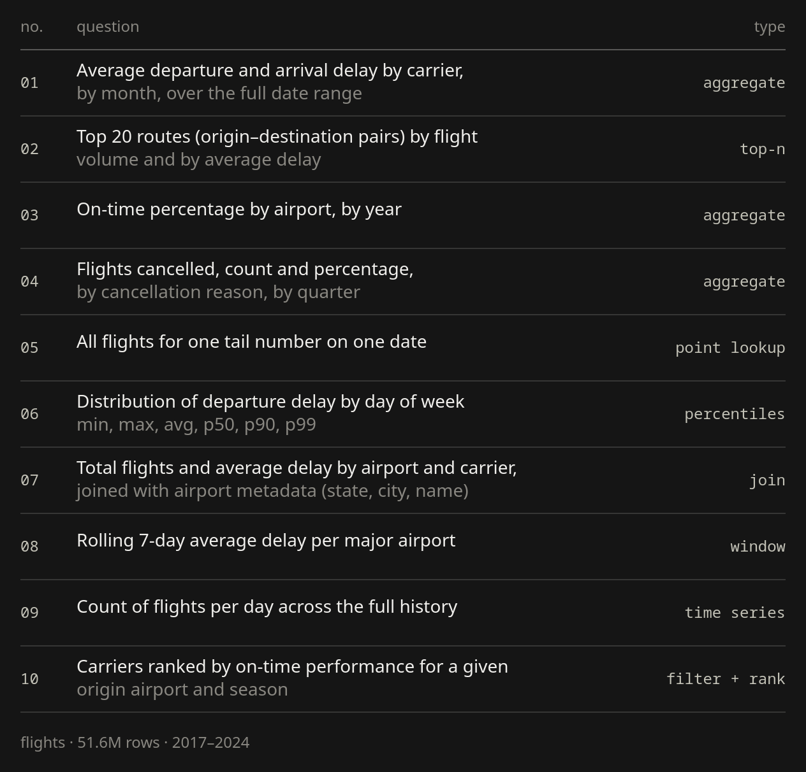

<div align="center">
  <br>
  
  <br>
</div>

<p align="center">
  BTS On-Time Performance (Air OnTime) · 2017-2024 · 51,642,689 rows · monthly CSVs · single node, ClickHouse 26.4.1
</p>

# bts-ch

What i do is raw naive optimizations using ClickHouse's features skipping the data modelling step. This does not necessarily mean data modelling is not needed, it's just not what this repo is aiming for. Adding that step will only introduce unnecessary complexity :) *why with the informality you may ask? i just think if something like desc is written more human and not just some boring compact informational AI slop the world would be way cooler )) (russian smiley face btw)

## detailed bench results

<div align="center">
  <br>
  
  <p>naive vs tuned US flight delays in ClickHouse</p>
  <br>
</div>


## questions

<div align="center">
  
</div>

## run it yourself

```bash
docker compose up -d
scripts/load.sh      # BTS 2017-2024 from transtats, builds everything in sql/
scripts/bench.sh     # 3 warmup, 20 runs per query
```
