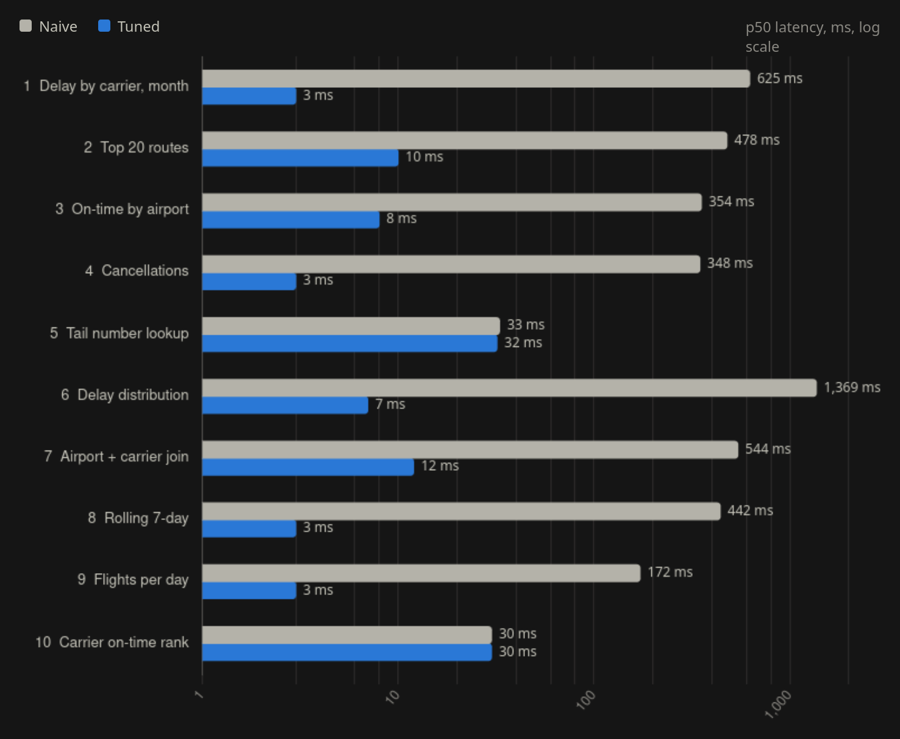
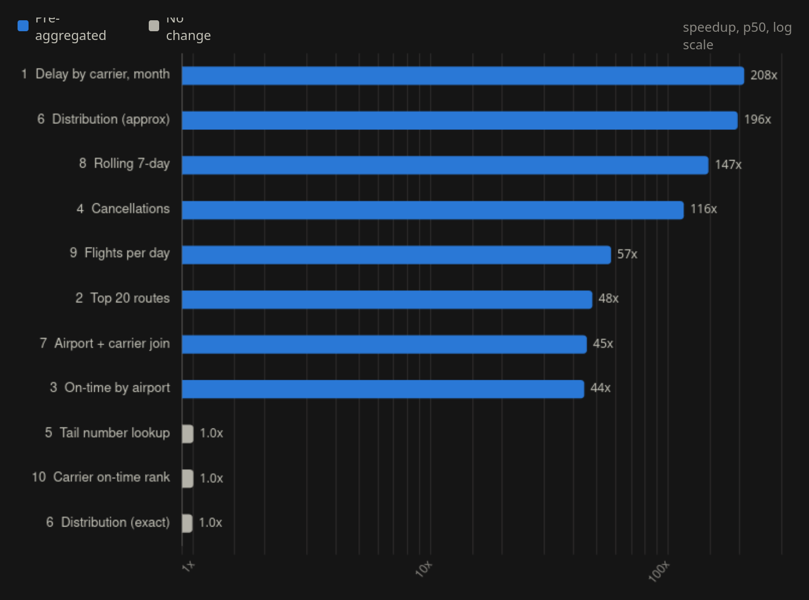

# bts-ch

<div align="center">
  <br>
  
  <p>naive vs tuned US flight delays in ClickHouse</p>
  <br>
</div>

## dataset

<p align="center">
  BTS On-Time Performance (Air OnTime) · 2017-2024 · 51,642,689 rows · monthly CSVs · single node, ClickHouse 26.4.1
</p>

## benchmark

| | |
|---|---|
|  |  |

## questions

<div align="center">
  
</div>

## run it yourself

```bash
docker compose up -d
scripts/load.sh      # BTS 2017-2024 from transtats, builds everything in sql/
scripts/bench.sh     # 3 warmup, 20 runs per query
```
